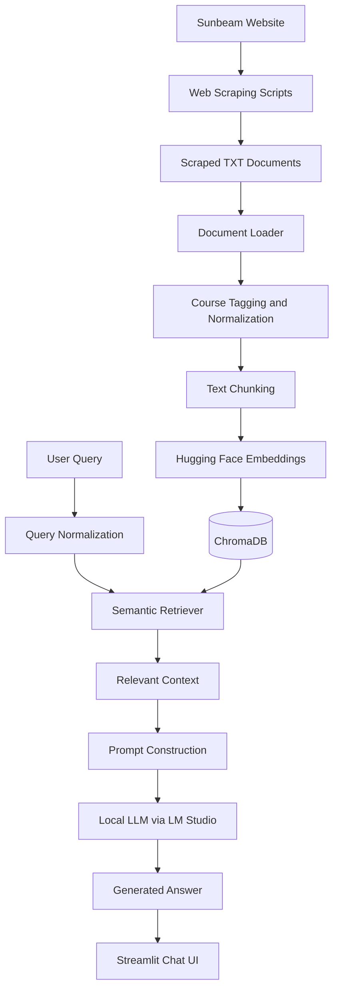

# 📚 Sunbeam Course Assistant — Local LLM & RAG Chatbot

A Retrieval-Augmented Generation (RAG) application that answers questions about Sunbeam Institute's courses using scraped institutional data, semantic search, vector embeddings, and a locally hosted Large Language Model (LLM).

Built with **Python, LangChain, ChromaDB, Hugging Face Embeddings, LM Studio, and Streamlit**, this project explores how domain-specific knowledge can be used to generate context-aware responses without relying on a cloud-hosted LLM API.

## 🚀 Project Overview

Finding accurate information about course fees, durations, eligibility criteria, syllabi, and batch schedules often requires searching through multiple web pages and documents.

The Sunbeam Course Assistant addresses this problem by converting scraped course information into searchable vector embeddings and retrieving relevant context before generating an answer through a local LLM.

**Key objective:** Build a domain-specific AI assistant that combines semantic retrieval with local LLM inference to answer questions using a curated knowledge base.

## ✨ Key Features

- **Domain-Specific Question Answering:** Answers questions about courses, fees, duration, eligibility, prerequisites, syllabi, and schedules using the ingested Sunbeam data.
- **Web Data Ingestion:** Loads scraped `.txt` documents containing course and institutional information.
- **Semantic Search:** Uses `all-MiniLM-L6-v2` embeddings to retrieve contextually relevant document chunks.
- **Vector Database:** Stores and retrieves embeddings using ChromaDB.
- **Retrieval-Augmented Generation:** Supplies retrieved context to an LLM to generate grounded answers.
- **Local LLM Inference:** Integrates with LM Studio's OpenAI-compatible local API, enabling inference without sending prompts to a hosted LLM provider.
- **Query Normalization:** Handles common variations and abbreviations, such as course length versus duration and Gen AI versus Generative AI.
- **Course and Section Metadata:** Enriches document chunks with course names and section labels to support structured retrieval.
- **Interactive Chat Interface:** Uses Streamlit to provide a conversational interface with session-based chat history.
- **Fallback Responses:** Returns a predefined message when the model indicates that the requested information is unavailable in the current knowledge base.

## 🏗️ System Architecture



## 🧠 How It Works

### 1. Data Collection

Web scraping scripts collect relevant information from Sunbeam Institute's website and save it as text files.

The knowledge base includes information such as:

- Institutional overview and contact details
- Internship information
- Course descriptions
- Course-specific details and syllabi
- Pre-CAT preparation information

### 2. Document Loading and Preprocessing

The `loader.py` module recursively loads `.txt` files from the scraped data directory using LangChain's `TextLoader`.

The ingestion pipeline then enriches each document with course metadata derived from its filename.

### 3. Text Chunking

`RecursiveCharacterTextSplitter` divides documents into smaller chunks to improve retrieval granularity.

| Parameter | Configuration |
|---|---|
| Chunk size | 350 characters |
| Chunk overlap | 50 characters |
| Course metadata | Added to each chunk |
| Section metadata | Fees, duration, eligibility, syllabus, schedule, or general |

Course and section labels are also included in the chunk content to provide additional context during semantic retrieval.

### 4. Embedding Generation and Vector Storage

The project uses the `all-MiniLM-L6-v2` sentence embedding model through LangChain's `HuggingFaceEmbeddings` integration.

Each chunk is converted into a numerical vector and stored in ChromaDB for subsequent similarity-based retrieval.

### 5. Retrieval-Augmented Generation

When a user submits a question:

1. The query is normalized to handle common terminology and abbreviations.
2. The retriever searches the vector database for the eight most relevant chunks.
3. The retrieved text is assembled into a context for the LLM.
4. A system prompt instructs the model to answer using only the supplied information.
5. The local LLM generates a response, which is displayed in the Streamlit chat interface.

The application also attempts targeted text extraction for categories such as fees, duration, eligibility, syllabus, and schedule before falling back to the general generation prompt.

### 6. Local Model Inference

The application connects to LM Studio through its OpenAI-compatible API endpoint.

This allows the chatbot to run inference using a locally hosted model rather than depending on a paid, cloud-hosted LLM API.

**Note:** Local inference reduces dependence on external model providers, but privacy still depends on the surrounding environment, model configuration, and data-handling practices.

## 🛠️ Technology Stack

| Component | Technology |
|---|---|
| Programming language | Python |
| LLM orchestration | LangChain |
| Embedding model | Hugging Face — `all-MiniLM-L6-v2` |
| Vector database | ChromaDB |
| Local LLM runtime | LM Studio |
| LLM integration | OpenAI-compatible local API |
| Text processing | RecursiveCharacterTextSplitter |
| Document loading | LangChain TextLoader |
| User interface | Streamlit |
| Data source | Scraped institutional web content |
| Version control | Git and GitHub |

## 📂 Project Structure

```text
Project-Sunbeam-Chatbot/
│
├── chroma_db/                     # Persistent vector database
├── myenv/                         # Python virtual environment
│
├── Scraping Sunbeam Data/
│   ├── courses/                   # Course-related data
│   ├── data/                      # Supporting data
│   ├── env/                       # Scraping environment, if used
│   ├── scraped data/              # Scraped text documents
│   ├── .env                       # Scraping configuration
│   ├── about_sunbeam.txt
│   ├── contact_us_full_data.txt
│   ├── internship_data.txt
│   ├── modular_course_mdid_57.txt
│   ├── precat_data.txt
│   ├── Scrap_INTERNSHIP.py
│   ├── scraping_About_Us.py
│   ├── scraping_certified_courses.py
│   ├── scraping_contactus.py
│   ├── scraping_MCQ.py
│   └── scraping_pre-cat.py
│
├── .gitignore
├── ingest.py                      # Ingestion and embedding pipeline
├── loader.py                      # Loads scraped text documents
├── main.py                        # Streamlit chat interface
├── rag_local.py                   # Retrieval and local LLM pipeline
├── requirements.txt               # Python dependencies
├── README.md
└── Screenshot_of_UI_01.png        # Application screenshots, if included
```

*The tree represents the main components of the project. Actual local folders and filenames may differ slightly.*

## ⚙️ Installation and Setup

### Prerequisites

- Python 3.10 or a compatible version supported by the installed dependencies
- Git
- LM Studio
- A locally available instruction-tuned LLM supported by your LM Studio setup
- Sufficient RAM and disk space for the selected model and embedding dependencies

### 1. Clone the repository

```bash
git clone <YOUR_GITHUB_REPOSITORY_URL>
cd Project-Sunbeam-Chatbot
```

Replace the placeholder with your actual public repository URL.

### 2. Create and activate a virtual environment

**Windows — PowerShell**

```powershell
python -m venv .venv
.\.venv\Scripts\Activate.ps1
```

**Windows — Command Prompt**

```bat
python -m venv .venv
.venv\Scripts\activate.bat
```

### 3. Install dependencies

```bash
python -m pip install --upgrade pip
pip install -r requirements.txt
```

Ensure `requirements.txt` contains the packages required by your current implementation, including:

```text
streamlit
langchain
langchain-community
langchain-huggingface
langchain-chroma
langchain-text-splitters
sentence-transformers
chromadb
```

Install any additional packages required by your scraping scripts. Pin tested versions in your actual requirements file for reproducibility.

### 4. Prepare the knowledge base

Ensure the scraped text files exist in the directory expected by `loader.py`:

```text
Scraping Sunbeam Data/
└── scraped data/
    ├── about_sunbeam.txt
    ├── contact_us_full_data.txt
    ├── internship_data.txt
    └── ...
```

The current loader expects this directory relative to the project root. If your actual folder name or location differs, update `DATA_DIR` in `loader.py` accordingly.

### 5. Configure LM Studio

1. Install and open LM Studio.
2. Download a compatible instruction-tuned model.
3. Load the model into the runtime.
4. Start the local API server.
5. Verify that the server is accessible at `http://localhost:1234/v1`.

The current `rag_local.py` configuration expects:

```python
llm = init_chat_model(
    model="meta-llama-3.1-8b-instruct",
    model_provider="openai",
    openai_api_base="http://localhost:1234/v1",
    api_key="dummy"
)
```

**Important:** The model identifier must match the model configuration supported by your installed LangChain version and local server. The API key shown here is a placeholder for local inference, not a real credential.

### 6. Build the vector database

From the project root, run:

```bash
python ingest.py
```

This loads the text documents, enriches their metadata, creates chunks, generates embeddings, and stores the resulting vectors in `chroma_db/`.

**Warning:** The current ingestion script deletes the existing `chroma_db/` directory before rebuilding it. Back up any data you need before rerunning ingestion.

### 7. Launch the chatbot

Start the Streamlit application:

```bash
streamlit run main.py
```

Open the local URL printed in the terminal and start asking questions about the available course information.

## 💬 Example Queries

Try questions such as:

```text
What are the fees for Core Java?

What is the duration of the Java course?

What are the prerequisites for Python Development?

Explain the syllabus for Machine Learning.

What is the duration of the Generative AI course?

Tell me about Sunbeam Institute.

What internship domains are available?
```

The quality of the response depends on the completeness of the scraped documents, retrieval relevance, and the capabilities of the locally hosted model.

## 🔍 Current Implementation and Limitations

This project is a practical implementation of a local RAG pipeline. It is important to distinguish the implemented functionality from potential future improvements.

- **Retrieval:** Uses similarity-based retrieval with `k=8`. Retrieval relevance has not yet been established through a formal evaluation benchmark.
- **Grounding:** The prompt instructs the LLM to use the supplied text, but prompt instructions alone cannot guarantee factual accuracy.
- **Section extraction:** Uses regular expressions for targeted extraction. It is a lightweight heuristic, not a complete structured information extraction system.
- **Query filtering:** Query normalization uses predefined replacements and may require refinement for ambiguous or complex questions.
- **Conversation memory:** Streamlit retains chat messages in session state, but the backend does not currently use conversation history to resolve follow-up questions.
- **Evaluation:** A systematic retrieval and answer-quality evaluation suite has not yet been implemented.
- **Agentic RAG:** The current pipeline retrieves context and invokes an LLM; it does not implement autonomous agents or tool-routing workflows.
- **Security:** Local inference avoids sending prompts to a hosted LLM API through the configured inference path, but comprehensive security controls and privacy audits are not implemented.
- **Deployment:** The current application is designed for local execution rather than a hardened production environment.

## 🔮 Future Enhancements

Potential next steps include:

- Add retrieval evaluation using Recall@K, Precision@K, and Mean Reciprocal Rank (MRR).
- Evaluate answer quality, relevance, and faithfulness against a curated test set.
- Introduce hybrid retrieval combining semantic search and keyword-based search.
- Add course-specific metadata filtering to reduce irrelevant cross-course results.
- Implement structured extraction for fees, durations, prerequisites, and schedules.
- Improve conversational follow-up handling through query rewriting and explicit chat-history integration.
- Explore reranking and context compression to improve retrieval quality and reduce prompt size.
- Add automated tests, logging, exception handling, and reproducible dependency management.
- Investigate agentic workflows where an LLM can choose between retrieval and approved structured-data tools.
- Add deployment, access controls, and security testing where required.

## 🎯 Learning Outcomes

Through this project, I explored:

- Building a document ingestion pipeline for unstructured data.
- Generating sentence embeddings and storing them in a vector database.
- Implementing semantic retrieval with LangChain and ChromaDB.
- Designing prompts for context-grounded LLM responses.
- Connecting a locally hosted LLM through an OpenAI-compatible API.
- Integrating a Python AI backend with an interactive Streamlit application.
- Understanding practical RAG limitations, including retrieval errors, incomplete source data, and hallucination risks.

## 👨‍💻 Author

**Atharv Kondekar**

B.Tech — Computer Science and Engineering, Artificial Intelligence and Machine Learning

Interested in Machine Learning, Generative AI, LLM applications, Retrieval-Augmented Generation, and applied AI engineering.

- **GitHub:** [Atharv Kondekar](https://github.com/atharv-kondekar)
- **LinkedIn:** www.linkedin.com/in/atharv-kondekar
## 📄 License

Add a `LICENSE` file if you intend to distribute this project under an open-source license. Before publishing, verify that the scraped content and any included third-party assets may be redistributed.

---

*Built as a hands-on project exploring domain-specific question answering using retrieval-augmented generation and local LLM inference.*